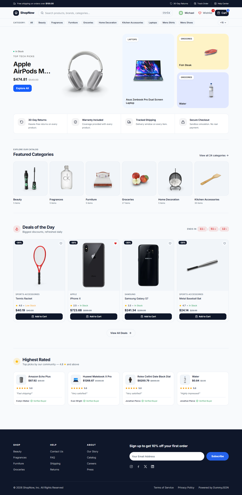

# ShopNow Store

**A complete online store you can browse, shop, and check out from — right in your browser.**

ShopNow is a front-end e-commerce demo that lets visitors explore products, save favorites, add items to a cart, apply discounts, and complete a checkout — just like a real online store. It's built entirely in the browser using a public demo API, so there's no signup, no payment, and no data collection. Everything runs safely on your own device.

---

## What You Can Do

- **Browse** 194 products across 24 categories
- **Search and filter** by brand, price, rating, and availability
- **Add to cart** with quantities and promo codes
- **Save to wishlist** — persists across sessions
- **Check out** as a guest with a multi-step form
- **Track your order** with a shipment timeline
- **Sign in** with a demo account (no signup needed)

---

## Screenshot

---

## Features

### Shopping Experience

- Product catalog with search, category browse, and full-text search
- Advanced filtering: brand, price range, rating, in-stock only
- Sort by price, rating, or title
- Pagination with URL state (shareable links)
- Responsive product grid (mobile-first, desktop-enhanced)

### Cart & Wishlist

- Cart with quantity controls, per-item removal, and clear-all
- Promo code support (`DUMMY15` = 15% off)
- Free-shipping progress bar ($100 threshold)
- Wishlist with persistence across browser sessions
- Both stored locally (Zustand + localStorage)

### Checkout Flow

- Guest checkout — no account required
- Multi-section form: contact, address, shipping, payment
- Real-time validation with helpful error messages
- Simulated order confirmation with generated order number
- Order tracking page with shipment timeline

### Authentication (Optional)

- Demo login using DummyJSON's auth API
- User avatar and dropdown menu in the header
- Session persists across refreshes

### Quality

- Fully responsive (mobile, tablet, desktop)
- Keyboard navigation and visible focus states
- ARIA labels on interactive elements
- Loading, empty, and error states everywhere
- Friendly error messages for network failures

---

## Tech Stack

| Layer         | Technology          |
| ------------- | ------------------- |
| Framework     | React 19            |
| Build tool    | Vite                |
| Styling       | Tailwind CSS 4      |
| UI primitives | shadcn/ui (Radix)   |
| Routing       | React Router 7      |
| State         | Zustand (persisted) |
| Forms         | React Hook Form     |
| HTTP          | Axios               |
| Icons         | lucide-react        |
| Notifications | Sonner              |

**Data source:** [DummyJSON](https://dummyjson.com) — a free, public REST API with mock product, user, and auth endpoints.
---
## Project Structure

<pre>
src/
├── api/          # Axios instance (base URL, timeout)
├── components/   # UI, grouped by domain
│   ├── cart/         # Cart item, summary, promo, shipping progress
│   ├── checkout/     # Checkout form
│   ├── home/         # Hero, categories, deals, ratings
│   ├── layout/       # Header, footer, search, user menu
│   ├── product/      # Gallery, info, tabs, related products
│   ├── products/     # Card, grid, filters, sort, pagination
│   └── ui/           # shadcn primitives (Button, Select)
├── hooks/        # Custom hooks (fetching, filtering, URL state)
├── layout/       # MainLayout wrapper
├── lib/          # Pure helpers (cart math, formatting, constants)
├── pages/        # Route-level components
└── store/        # Zustand stores (cart, wishlist, auth)
</pre>
